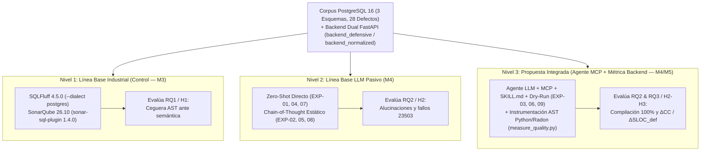

# LLM-Driven Audit and Optimization of PostgreSQL Schemas for Backend Quality Assurance

> **Título en Español:** *Auditoría y Optimización de Esquemas PostgreSQL mediante Modelos de Lenguaje (LLMs) para el Aseguramiento de la Calidad del Backend*  
> **Formato Objetivo:** IEEE Conference Template / ACM Primary Article Template (Estructura IMRyD)  
> **Asignatura:** Calidad de Software (Ciclo 6) — Evaluación $N_2$  
> **Docente Asesor:** Mg. Gustavo Arredondo Castillo  
> **Estado del Manuscrito:** Borrador Completo Consolidado e Integrado (M1 + M2 + M3 + M4 + M5)

---

## Abstract

Defects in relational database schema design, such as normalization anomalies (1NF–3NF) and missing foreign keys (*keyless entry*), propagate technical debt directly into backend application architectures. To compensate for missing database invariants, developers implement defensive validation layers—string parsing, pre-mutation `SELECT COUNT(*)` checks, and manual denormalization synchronization—that inflate McCabe Cyclomatic Complexity ($CC$) and expose concurrent systems to Time-of-Check to Time-of-Use (TOCTOU) race conditions. Although modern CI/CD pipelines delegate SQL quality assurance to Abstract Syntax Tree (AST)-based linters (e.g., SQLFluff, SonarQube), these static tools exhibit complete semantic blindness toward relational dependencies. In this paper, we empirically evaluate a tripartite experimental framework standardized on PostgreSQL 16 across three canonical and synthetic benchmarks (Pagila, Northwind-PG, and a DNBench-style fault-injection schema totaling 28 documented relational defects), integrated with a dual FastAPI backend suite. First, we confirm that traditional AST linters achieve 0/28 relational detections (100% false negative rate) despite emitting 322 stylistic warnings and passing all CI Quality Gates. Second, we contrast raw prompting baselines against an Autonomous Agent augmented with the Model Context Protocol (MCP), a structured five-stage procedural Chain-of-Thought skill (`postgres-schema-auditor`), empirical row sampling (`LIMIT 5`), and deterministic transactional Dry-Run validation (`BEGIN...ROLLBACK`). Under deterministic decoding, Zero-Shot prompts exhibit a 43.75% foreign key hallucination rate (7/16) and 0% DDL compilability, and static CoT achieves 100% theoretical diagnosis yet 0% execution success due to uninspected orphan rows (PostgreSQL SQLSTATE `23503`), whereas the MCP Agentic architecture reaches 100% precision, recall, and $F_1$-score with 0% hallucinations and 100% DDL compilability (3/3) in an average of 1.67 iterations. Finally, empirical measurements on the resulting normalized backend under ISO/IEC 25010 demonstrate up to a 57.1% reduction in endpoint Cyclomatic Complexity (42.86% mean reduction across CC-affected endpoints; 31.03% across all router endpoints; 22.2% across the full microservice package), complete elimination (100%) of defensive source lines ($SLOC_{def}: 24 \to 0$) and redundant prior queries ($Q_{prev}: 6 \to 0$, including an $O(N)$ per-item query loop), transitioning 100% of endpoints to Radon Risk Rank A ($CC \le 4$).

**Keywords:** Database Schema Smells, Large Language Models, Model Context Protocol, Dry-Run Verification, Cyclomatic Complexity, Software Maintainability, ISO/IEC 25010, PostgreSQL.

---

## Resumen

Los defectos en el diseño de esquemas relacionales —como las anomalías de normalización (1FN, 2FN y 3FN) y la omisión de restricciones `FOREIGN KEY`— trasladan deuda técnica directamente hacia la capa de aplicación *backend*. Para suplir las invariantes ausentes en la base de datos, los desarrolladores introducen rutinas defensivas (deserialización manual de cadenas, consultas previas `SELECT COUNT(*)` y sincronización manual de atributos redundantes) que incrementan la Complejidad Ciclomática de McCabe ($CC$) y exponen al sistema a condiciones de carrera (*race conditions* TOCTOU). Aunque los pipelines actuales de CI/CD delegan la auditoría SQL a analizadores estáticos basados en Árboles de Sintaxis Abstracta (AST) como SQLFluff y SonarQube, estas herramientas sufren ceguera semántica frente a las dependencias funcionales. En este artículo se evalúa un marco experimental tripartito estandarizado en PostgreSQL 16 sobre tres esquemas (Pagila, Northwind-PG y un micro-benchmark sintético inspirado en DNBench, sumando 28 defectos inyectados) acoplados a una arquitectura *backend* dual en FastAPI. Los resultados confirman que los linters AST tradicionales obtienen un 100% de falsos negativos (0/28 detecciones relacionales) pese a emitir 322 avisos de estilo y aprobar los *Quality Gates*. Frente a los *prompts* pasivos —donde Zero-Shot arrojó 43.75% de alucinaciones de claves foráneas y 0% de compilación DDL, y el razonamiento *Chain-of-Thought* estático obtuvo 100% de diagnóstico teórico pero 0% de compilación por registros huérfanos no inspeccionados (`23503`)—, el Agente Autónomo asistido por *Model Context Protocol* (MCP), la *Skill* procedimental (`postgres-schema-auditor`), muestreo de datos (`LIMIT 5`) y validación *Dry-Run* determinista (`BEGIN...ROLLBACK`) alcanzó 100% de precisión, *recall* y $F_1$-score, 0% de alucinaciones y 100% de DDL compilable en un promedio de 1.67 iteraciones. Finalmente, el análisis empírico sobre el *backend* normalizado bajo la norma ISO/IEC 25010 evidencia reducciones de hasta 57.1% en la complejidad ciclomática por endpoint (42.86% en rutas afectadas por $CC$, 31.03% en el conjunto de controladores y 22.2% en todo el paquete), la erradicación total (100%) de líneas de código defensivo ($SLOC_{def}: 24 \to 0$) y consultas previas ($Q_{prev}: 6 \to 0$, incluyendo una consulta $O(N)$ dentro de bucles), logrando que el 100% de los endpoints operen en Rango A de Radon ($CC \le 4$).

**Palabras Clave:** *Database Schema Smells*, Modelos de Lenguaje (LLMs), *Model Context Protocol* (MCP), Validación *Dry-Run*, Complejidad Ciclomática, Mantenibilidad de Software, ISO/IEC 25010, PostgreSQL.

---

## I. Introduction (Introducción)

### A. Acoplamiento Simbiótico y Traslación de Deuda Técnica hacia el Backend

En la ingeniería de sistemas empresariales contemporáneos, la capa de persistencia relacional y los servicios de lógica de aplicación mantienen un acoplamiento estructural estrecho. Conforme a la teoría relacional clásica \cite{codd1970relational}, las formas normales y las restricciones referenciales declarativas existen para garantizar la atomicidad e integridad de los hechos almacenados directamente dentro del Sistema Gestor de Bases de Datos Relacionales (RDBMS). Sin embargo, en la práctica industrial acelerada —impulsada frecuentemente por prototipado rápido o configuraciones laxas de mapeadores objeto-relacionales (ORMs)— proliferan defectos de diseño conocidos como *database schema smells* \cite{karwin2010sql, sharma2018smelly}.

Cuando un esquema en PostgreSQL omite restricciones `FOREIGN KEY` (*keyless entry*), almacena colecciones delimitadas por comas en columnas textuales (*jaywalking* / violación de Primera Forma Normal, 1FN) o preserva dependencias parciales (2FN) y transitivas (3FN), la invariante del dominio no desaparece: se produce un fenómeno de **traslación de deuda técnica**. La aplicación *backend* hereda la obligación de suplir al motor relacional mediante capas de programación defensiva: rutinas de deserialización manual en memoria (`split`, expresiones regulares), consultas previas de verificación existencial (`SELECT COUNT(*)`, `SELECT EXISTS`) antes de cada escritura o borrado, y bifurcaciones condicionales adicionales para sincronizar valores replicados. Como consecuencia directa, se degrada la analizabilidad del software al inflar la Complejidad Ciclomática de McCabe ($CC$) \cite{mccabe1976complexity}, se introduce latencia adicional por viajes de red redundantes ($O(N)$ en operaciones por lote) y se abren ventanas de vulnerabilidad ante condiciones de carrera (*Time-of-Check to Time-of-Use*, TOCTOU) que la capa web no puede mitigar de manera atómica sin bloquear recursos.

### B. La Ceguera Epistemológica del Análisis Estático en CI/CD

Para contener la deuda técnica en etapas tempranas (*shift-left quality assurance*), los flujos modernos de integración y despliegue continuos (CI/CD) confían la revisión de scripts de Definición de Datos (DDL) a analizadores estáticos basados en Árboles de Sintaxis Abstracta (AST), entre los que destacan SQLFluff y SonarQube. No obstante, estas herramientas operan bajo una limitación epistemológica fundamental: sus analizadores léxicos y sintácticos verifican la conformidad respecto a la gramática BNF del dialecto objetivo y convenciones estilísticas (espaciado, capitalización, orden de cláusulas), pero carecen de capacidad inferencial para razonar sobre el dominio semántico, identificar dependencias funcionales no triviales ($X \rightarrow Y$) ni advertir la ausencia implícita de integridad referencial. En consecuencia, un script DDL sintácticamente impecable pero relacionalmente defectuoso supera los *Quality Gates* automatizados ("*Passed*") e ingresa a producción, perpetuando la sobrecarga defensiva en el código *backend*.

### C. Preguntas de Investigación e Hipótesis

Con el objetivo de evaluar rigurosamente el impacto de sustituir auditorías sintácticas pasivas y prompts heurísticos por un flujo agéntico anclado en el motor de base de datos, esta investigación responde a tres preguntas científicas ($RQ$):

* **$RQ_1$ (Línea Base Tradicional):** *¿Hasta qué punto los analizadores estáticos tradicionales basados en AST (SQLFluff con dialecto PostgreSQL y SonarQube) omiten defectos semánticos de normalización (1FN, 2FN, 3FN) y omisiones de claves foráneas en scripts DDL?*
* **$RQ_2$ (Arquitectura Agentic AI vs. Prompts Crudos):** *¿Cómo contrasta la precisión diagnóstica, la tasa de alucinación de restricciones y la tasa de compilación DDL en PostgreSQL entre un Agente Autónomo asistido por herramientas (Model Context Protocol, Skill procedimental y validación transaccional Dry-Run) frente a estrategias pasivas Zero-Shot y Chain-of-Thought sin herramientas?*
* **$RQ_3$ (Impacto Cuantitativo en el Backend e ISO/IEC 25010):** *¿En qué magnitud la refactorización normalizada del esquema PostgreSQL reduce la Complejidad Ciclomática de McCabe ($CC$), las líneas de código defensivo ($SLOC_{def}$) y las consultas previas ($Q_{prev}$) en los controladores backend, elevando la mantenibilidad y fiabilidad conforme a la norma ISO/IEC 25010?*

A partir de la revisión de literatura, se formularon a priori las siguientes tres hipótesis experimentales:
* **$H_1$:** Los linters basados en AST arrojan un 100% de falsos negativos frente a los cuatro tipos de defectos relacionales evaluados, aprobando los scripts DDL como válidos.
* **$H_2$:** El Agente Autónomo equipado con introspección vía MCP y verificación *Dry-Run* supera el 90% de precisión diagnóstica y reduce a 0% las alucinaciones de claves foráneas y el DDL inejecutable, superando ampliamente a los prompts pasivos (~40% de fallos).
* **$H_3$:** La normalización declarativa del esquema en PostgreSQL logra una reducción sustancial de la complejidad ciclomática ($\Delta CC \ge 50\%$) y elimina el 100% de las líneas de código defensivo ($SLOC_{def} \to 0$) y consultas de verificación previa ($Q_{prev} \to 0$).

### D. Contribuciones Principales

Este artículo aporta cuatro contribuciones verificables y reproducibles:
1. **Benchmark Multi-Nivel Reproducible en PostgreSQL 16:** Un corpus unificado de tres esquemas relacionales (Pagila, Northwind-PG y un micro-benchmark sintético estilo DNBench con 28 defectos trazables en manifiestos JSON) acoplado a una pareja de servicios *backend* funcionalmente equivalentes en FastAPI (`backend_defensive` vs. `backend_normalized`) certificados mediante pruebas de contrato.
2. **Evidencia Empírica de Ceguera Semántica en Linters Industriales:** La demostración controlada mediante SQLFluff 4.5.0 y SonarQube 26.10 (con controles positivos independientes) de que las herramientas AST de uso extendido presentan una tasa de falsos negativos del 100% ante violaciones 1FN–3FN y *keyless entry*.
3. **Arquitectura de Agente MCP con Bucle Cerrado Dry-Run:** La especificación e instrumentación de la *Skill* procedimental `postgres-schema-auditor`, demostrando empíricamente la **"Paradoja del Chain-of-Thought sin Grounding"** (100% diagnóstico teórico pero 0% ejecutable ante filas huérfanas reales) y su resolución completa mediante muestreo `LIMIT 5` y captura transaccional `BEGIN...ROLLBACK`.
4. **Cuantificación End-to-End del Diferencial de Calidad Backend ($\Delta$) bajo ISO/IEC 25010:** El primer enlace empírico documentado entre normalización automatizada con LLMs y métricas deterministas de código de aplicación ($CC$, $SLOC_{def}$, $Q_{prev}$ y mitigación TOCTOU).

---

## II. Related Work (Trabajos Relacionados)

### A. Database Smells, Deuda Técnica y Análisis Estático Tradicional

La fundamentación matemática de la integridad relacional parte de las formas normales introducidas por Codd \cite{codd1970relational}, diseñadas para erradicar anomalías de inserción, actualización y borrado mediante la descomposición sin pérdida de dependencias funcionales. Posteriormente, Karwin \cite{karwin2010sql} sistematizó los antipatrones recurrentes en la industria —destacando *Jaywalking* (violación de 1FN mediante listas delimitadas por comas) y *Keyless Entry* (omisión deliberada de restricciones `FOREIGN KEY`)— advirtiendo cómo estos defectos trasladan la responsabilidad de validación hacia la capa de software. En un estudio empírico a gran escala sobre 2,925 repositorios, Sharma et al. \cite{sharma2018smelly} formalizaron una taxonomía de 13 *database schema smells* y demostraron que la adopción de mapeadores objeto-relacionales (ORMs) no previene la proliferación de anomalías estructurales. Si bien Ambler y Sadalage \cite{ambler2006refactoring} documentaron patrones manuales seguros para la refactorización evolutiva preservando datos en producción, los pipelines modernos de CI/CD delegan el control de calidad SQL en linters basados en AST (como SQLFluff y SonarQube). Investigaciones recientes sobre categorización estática como *SQLMentor* \cite{miggiano2025automatic} corroboran que los analizadores basados en reglas sobre AST (`sqlglot`) alcanzan alta precisión frente a errores estrictamente gramaticales —llegando a superar a modelos LLM genéricos en detección sintáctica rígida—, pero pierden eficacia ante errores semánticos o lógicos que exigen comprender la intención y el contexto relacional. De manera complementaria, *SQLFlex* \cite{an2026dialect} evidencia la fragilidad de los parsers gramaticales (ANTLR y SQLFluff en modo ANSI) frente a sintaxis complejas de múltiples dialectos, hibridando segmentación con `GPT-4.1`; no obstante, tanto *SQLMentor* como *SQLFlex* se limitan al análisis y parsing de consultas sin abordar la auditoría estructural DDL ni la calidad del *backend*.

### B. Evolución de los LLMs en Bases de Datos y Normalización Agéntica

El uso de Modelos de Lenguaje (LLMs) en ingeniería de datos estuvo históricamente dominado por tareas *Text-to-SQL*. Benchmarks influyentes como Spider \cite{yu2018spider} y BIRD \cite{li2023bird} evaluaron la traducción semántica hacia consultas `SELECT`, revelando en el caso de BIRD que los modelos caen drásticamente en precisión cuando enfrentan datos reales sucios sin mecanismos de anclaje (*grounding*) sobre las tuplas almacenadas —fenómeno vinculado a los *data smells* catalogados por Foidl et al. \cite{foidl2022data}. Aunque técnicas de razonamiento estructurado como *Chain-of-Thought* (CoT) \cite{wei2022chain} mejoran la deducción lógica paso a paso, aplicarlas aisladamente sobre archivos DDL estáticos conduce a alucinaciones de catálogo y scripts inejecutables. Recientemente, de Medeiros et al. \cite{demedeiros2026llm} formalizaron la tarea diferenciada de remediación **DDL-to-DDL**, enfocada en refactorización segura y explicable de esquemas ante claves ausentes y mala normalización. En la frontera de la normalización con IA, *Miffie* \cite{jo2025database} propuso bucles duales generador-verificador; *NormaScore* \cite{ramachandran2026normascore} integró `Qwen2.5-7B-Instruct` optimizado con ajuste fino y aprendizaje por refuerzo (GRPO) junto a algoritmos deterministas de cierre de atributos sobre `NormaBench` (113 problemas), probando que evaluar solo el texto generado oculta pérdidas de información estructural; y Koh et al. introdujeron *DNBench* (3,275 muestras) y el marco multi-agente *MARS* \cite{dnbench2026can}, documentando tres fallos sistemáticos en LLMs: inferencia errónea de dependencias en casos realistas, reconstrucción defectuosa de tablas y tendencia a sobrenormalizar esquemas ya válidos. Sin embargo, todas estas propuestas se detienen dentro de los límites de la base de datos o contextos educativos, sin acoplar validación transaccional atómica contra datos huérfanos vivos ni medir el efecto en la capa de software.

### C. Acoplamiento con la Calidad del Código Backend e ISO/IEC 25010

En la ingeniería de software, McCabe \cite{mccabe1976complexity} y la guía de referencia del NIST \cite{nist_sp500_235} establecieron la Complejidad Ciclomática ($CC$) como la métrica estructural determinista para cuantificar rutas linealmente independientes en el grafo de flujo de control ($CFG$), correlacionada directamente con la densidad de defectos y el esfuerzo de pruebas. Bajo el modelo de calidad del producto ISO/IEC 25010 \cite{iso25010_2011}, la acumulación de bifurcaciones defensivas innecesarias degrada las subcaracterísticas de *Analizabilidad*, *Modificabilidad* y *Modularidad* (Mantenibilidad), a la vez que compromete la *Tolerancia a fallos* e *Integridad de datos* (Fiabilidad).

### D. Síntesis Comparativa y Brechas de Investigación

La Tabla I sintetiza los estudios representativos seleccionados mediante nuestra Revisión Sistemática de Literatura (SLR). De su análisis emergen **tres brechas científicas críticas**: *(i)* la asimetría entre la madurez de *Text-to-SQL* y la escasez de auditoría automatizada **DDL-to-DDL** sobre esquemas existentes; *(ii)* la insuficiencia tanto de linters AST ciegos a la semántica (*SQLFluff*, *SQLMentor*, *SQLFlex*) como del razonamiento CoT estático desconectado del motor físico; y *(iii)* la desconexión empírica total entre la normalización automatizada con LLMs y las métricas cuantitativas de deuda técnica en el código *backend*.

| Estudio / Marco de Referencia | Enfoque / Técnica | Auditoría DDL / Normalización | Introspección Viva + *Dry-Run* | Mide Impacto en Backend ($\Delta CC$, $SLOC_{def}$) | Vacío Principal Identificado |
| :--- | :--- | :---: | :---: | :---: | :--- |
| Codd \cite{codd1970relational}; Ambler \cite{ambler2006refactoring} | Álgebra relacional y refactorización manual | Manual | N/A | No | Sin automatización ni métricas de software. |
| Karwin \cite{karwin2010sql}; Sharma et al. \cite{sharma2018smelly} | Antipatrones SQL y *DbDeo* (13 *smells*) | Diagnóstico DDL | No | No | Identifica *smells*, no mide $\Delta CC$ ni usa LLMs. |
| McCabe \cite{mccabe1976complexity}; NIST \cite{nist_sp500_235}; ISO \cite{iso25010_2011} | Grafo $CFG$ y estándar SQuaRE | No | N/A | Marco teórico | No vincula la métrica $CC$ a anomalías del esquema BD. |
| Miggiano \cite{miggiano2025automatic} (*SQLMentor*); An et al. \cite{an2026dialect} (*SQLFlex*) | Reglas `sqlglot` AST; ANTLR + `GPT-4.1` | No (solo consultas) | No | No | Enfocados en sintaxis/parsing SQL; ignoran normalización 1FN–3FN y *backend*. |
| Spider \cite{yu2018spider}; BIRD \cite{li2023bird}; Foidl et al. \cite{foidl2022data} | *Text-to-SQL* y *Data Smells* | No (asume DDL sano) | Parcial (datos) | No | No audita ni repara esquemas relacionales. |
| de Medeiros et al. \cite{demedeiros2026llm}; NormaScore \cite{ramachandran2026normascore}; Miffie \cite{jo2025database}; DNBench/MARS \cite{dnbench2026can} | Remediación **DDL-to-DDL**, GRPO+cierre, Dual-LLM y Multi-Agente | Sí (1FN–BCNF / FKs) | No transaccional | No | Se detiene en la BD o evaluación educativa; ignora calidad del *backend*. |
| **Presente Estudio** | **Agente MCP + Skill CoT + Dry-Run + AST M5** | **Sí (1FN–3FN + FK)** | **Sí (PostgreSQL 16)** | **Sí ($\Delta CC$, $SLOC_{def}$, $Q_{prev}$)** | **Cierra el ciclo completo Esquema $\leftrightarrow$ Backend.** |

---

## III. Experimental Methodology (Metodología Experimental)

### A. Diseño Experimental Tripartito y Aislamiento de Variables

Para preservar la validez interna y aislar estrictamente la capacidad de diagnóstico relacional y su repercusión en la capa *backend*, toda la experimentación se estandarizó en un único motor gestor: **PostgreSQL 16** ejecutado de forma aislada dentro de un contenedor Docker reproducible (`proyectocalidaddesoftware-postgres-1`). Se descartó intencionalmente la evaluación multi-motor para eliminar sesgos derivados de divergencias en catálogos internos (`pg_catalog` vs. motores alternativos), dialectos de tipos de datos o semánticas de almacenamiento no transaccionales. Sobre este entorno unificado, el experimento contrasta tres niveles metodológicos escalonados:

### B. Corpus Experimental, Taxonomía de Defectos y Backend Dual

El banco de pruebas integra **tres esquemas nativos en PostgreSQL** (`TIMESTAMPTZ`, `GENERATED ALWAYS AS IDENTITY`, restricciones declarativas formales), cada uno provisto de su versión defectuosa (`schema_defective.sql`), su estándar de oro normalizado (`schema_ground_truth.sql`), datos semilla con anomalías reales (`seed_defective.sql`) y un manifiesto JSON legible por máquina (`defects_manifest.json`) con **28 defectos relacionales inyectados** en total (Tabla II). Asimismo, cada manifiesto cataloga explícitamente los *smells* heredados nativos de Sakila/Northwind (`known_native_smells`, p. ej., `customers.postal_code -> city` en Northwind) para garantizar que la puntuación de falsos positivos no penalice diagnósticos válidos fuera de los 28 defectos inyectados.

| Caso de Estudio | Dominio | Tablas (Def $\to$ GT) | Defectos Inyectados | Desglose Taxonómico (1FN / 2FN / 3FN / FK) | Anomalías Semilla Deliberadas |
| :--- | :--- | :---: | :---: | :---: | :--- |
| **Caso 1: Pagila** (`case1_pagila`) | Núcleo OLTP de alquileres e inventario | $15 \to 16$ | **10** | `1` / `2` / `2` / `5` | Listas CSV en `film.special_features`; huérfano `inventory.film_id = 999`, `rental.inventory_id = 999`, `payment.rental_id = 999`. |
| **Caso 2: Northwind-PG** (`case2_northwind`) | Órdenes, clientes, productos y envíos | $14 \to 15$ | **10** | `1` / `2` / `1` / `6` | Lista CSV en `customers.phones` (con separadores mixtos); huérfano `orders.customer_id = 'ZZZZZ'`, `ship_via = 99`, `order_details.product_id = 999`. |
| **Caso 3: Sintético Control** (`case3_synthetic`) | Micro-benchmark estilo DNBench \cite{dnbench2026can} | $5 \to 7$ | **8** | `1` / `2` / `1` / `4` | Teléfonos con delimitadores mixtos `[,;]`; dependencia `codigo_postal -> ciudad`; huérfano `envios.pedido_id = 999`. |
| **Total del Corpus** | — | — | **28** | **`3` / `6` / `4` / `15`** | **Cobertura completa de las 4 clases de *database smells*.** |

*(Nota de precisión arquitectónica del corpus: en Northwind-PG se incorporaron las 14 tablas completas del puerto oficial `northwind_psql`, incluyendo `us_states`; en Pagila se aisló el núcleo OLTP de 15 tablas excluyendo extensiones vectoriales `pgvector` y particiones para asegurar portabilidad pura en PostgreSQL 16/17).*

Los cuatro tipos de defectos auditados se corresponden con la taxonomía acordada:
1. **Violación de 1FN (*Jaywalking*):** Atributos multivaluados almacenados en texto plano CSV (`film.special_features`, `customers.phones`, `clientes.telefonos`).
2. **Violación de 2FN (Dependencia Parcial):** Atributos descriptivos no primos dependientes de un subconjunto propio de una clave primaria compuesta (`actor_full_name` y `category_name` en Pagila; `product_name` y `quantity_per_unit` en `order_details` de Northwind; `nombre_producto` y `categoria_producto` en `detalle_pedido` del caso Sintético).
3. **Violación de 3FN (Dependencia Transitiva):** Dependencias entre columnas no clave (`inventory.film_title`, `address.city_name`, `orders.shipper_name`, `clientes.ciudad` vía `codigo_postal`).
4. **Ausencia de Claves Foráneas (*Keyless Entry*):** Omisión deliberada de cláusulas `FOREIGN KEY`, permitiendo la inserción de registros huérfanos.

Para cuantificar el impacto en el código de aplicación ($RQ_3$), se construyó una arquitectura *backend* dual asíncrona en **Python 3.12 + FastAPI + `asyncpg`**: `backend_defensive/` (adaptada a los esquemas defectuosos de Pagila y Northwind, con bloques compensatorios etiquetados explícitamente mediante `# >>> DEFENSIVE-BEGIN` y `# <<< DEFENSIVE-END`) y `backend_normalized/` (apoyada en las restricciones y normalización del esquema optimizado). Ambas implementaciones exponen 7 endpoints equivalentes (`crear_cliente`, `obtener_cliente`, `poner_inventario`, `obtener_inventario`, `borrar_inventario`, `crear_pedido`, `obtener_pedido`), ejercitando **12 de los 20 defectos de esquema** de Pagila y Northwind (los 8 restantes son puramente estructurales de esquema sin ruta REST asociada). La equivalencia funcional estricta se certificó ejecutando la misma suite de **10 pruebas funcionales agnósticas de contrato** (`pytest tests/test_contract.py`), garantizando códigos HTTP (`201`, `200`, `204`, `404`, `409`, `422`) y payloads idénticos ante entradas válidas e inválidas.

### C. Instrumentación de Línea Base Tradicional (Nivel 1)

Los tres archivos `schema_defective.sql` intactos —cuya integridad criptográfica se fijó mediante huellas SHA-256 (`inputs.sha256.txt`)— fueron evaluados por dos analizadores estáticos representativos de la industria:
1. **SQLFluff v4.5.0:** Ejecutado con Python 3.12.10, configuración explícita `dialect = postgres`, `templater = raw`, `max_line_length = 100` y las **79 reglas estándar activas sin exclusiones ad hoc**.
2. **SonarQube Community Build v26.10.0.133078 + `sonar-sql-plugin` v1.4.0:** Ejecutado vía SonarScanner CLI v8.1.0.6389 utilizando el perfil completo `SQL rules` (20 reglas activas, `sonar.sql.dialect = pssqlv2`).

Para descartar fallos de configuración o falsos negativos triviales, se incorporaron **dos controles positivos independientes** externos al benchmark: `control_style.sql` (con doble espacio antes de `AS`, validando el disparo de la regla `LT01` en SQLFluff) y el proyecto aislado `calidadsw-m3-header` conteniendo `header_control.sql` sin comentario de cabecera (validando el disparo de `SQLCC:C030` en SonarQube). Se contabilizó un Verdadero Positivo ($TP$) únicamente cuando un diagnóstico describía la anomalía relacional concreta documentada en `defects_manifest.json`; la coincidencia espacial de línea por avisos cosméticos (espaciado o mayúsculas) no se consideró detección semántica.

### D. Arquitectura del Agente Autónomo con MCP y Validación Dry-Run (Nivel 2 vs. Nivel 3)

La matriz experimental de Inteligencia Artificial comprende **9 configuraciones (`EXP-01` a `EXP-09`)**, cruzando los 3 esquemas del corpus con 3 condiciones metodológicas bajo decodificación determinista (*Greedy Decoding*) configurada en `config/inference_config.json` ($T = 0.0$, $Top\text{-}K = 1$, $Top\text{-}P = 1.0$, $\text{seed} = 42$, penalizaciones en $0.0$, presupuesto de razonamiento `high` sobre el identificador de perfil `gemini-3.8-flash`):

1. **Nivel 2A — LLM Crudo Zero-Shot (`EXP-01`, `EXP-04`, `EXP-07`):** Recibe exclusivamente el archivo de texto `schema_defective.sql` con una instrucción directa de normalizar a 3FN e inferir claves foráneas, sin introspección ni *Chain-of-Thought*.
2. **Nivel 2B — LLM con Chain-of-Thought Estático (`EXP-02`, `EXP-05`, `EXP-08`):** Suministra la estructura metodológica de 5 etapas definida en `SKILL.md`, pero operando sin conectividad MCP ni validación contra PostgreSQL vivo.
3. **Nivel 3 — Agente Autónomo MCP + Skill + Dry-Run (`EXP-03`, `EXP-06`, `EXP-09`):** Equipa al modelo con conectividad directa a la instancia PostgreSQL 16 mediante el servidor `@modelcontextprotocol/server-postgres` (`config/mcp_postgres.json`), la herramienta de introspección `tools/introspect_db.py`, la especificación procedimental `postgres-schema-auditor/SKILL.md` y el validador transaccional determinista `tools/dry_run_validator.py`. La *Skill* estructura el razonamiento formal en 5 etapas cognitivas (*1. Introspección del catálogo*, *2. Muestreo empírico de 1FN*, *3. Inferencia formal $X \rightarrow Y$*, *4. Diagnóstico taxonómico* y *5. Emisión DDL*), las cuales se operacionalizan en tiempo de ejecución en **4 fases de bucle cerrado**:
   - **Fase 1 (Introspección Estructural y Auditoría Viva):** Consulta `information_schema.tables`, `columns` y `table_constraints`, además de ejecutar verificaciones proactivas de filas huérfanas (`WHERE col NOT IN (...)`).
   - **Fase 2 (Muestreo Semántico Activo):** Ejecuta consultas controladas `SELECT <col> FROM <tabla> WHERE <col> IS NOT NULL AND <col> <> '' LIMIT 5` para verificar evidencia física de cadenas compuestas antes de dictaminar violaciones de 1FN o 3FN.
   - **Fase 3 (Generación de DDL Determinista Nativo):** Produce el script de migración con tablas nuevas (`GENERATED ALWAYS AS IDENTITY` o claves compuestas), migración de datos atómica (`string_to_array` / `regexp_split_to_array` + `unnest`), saneamiento previo, eliminación de columnas redundantes y declaración explícita de restricciones `FOREIGN KEY ... ON DELETE` e índices de rendimiento.
   - **Fase 4 (Bucle Determinista Dry-Run `BEGIN ... ROLLBACK`):** Somete el DDL generado a compilación y ejecución real dentro de una transacción revertida en PostgreSQL 16. Ante cualquier excepción `psycopg.Error` (e.g., código `23503` por integridad referencial o `42830`/`42703`), el agente captura el código SQLSTATE y detalle del motor como retroalimentación determinista, corrige el script y reintenta hasta lograr el 100% de éxito compilatorio sin modificar persistentemente la base de datos.

Para la evaluación cuantitativa en $RQ_2$ se computaron $Precision = \frac{TP}{TP + FP}$, $Recall = \frac{TP}{TP + FN}$, $F_1\text{-Score} = \frac{2 \cdot Precision \cdot Recall}{Precision + Recall}$, **Tasa de Compilación DDL (%)** y **Tasa de Alucinación de FKs (%)** sobre el total de restricciones foráneas propuestas.

### E. Marco Métrico Formal de Calidad Backend e ISO/IEC 25010

La evaluación cuantitativa sobre el código fuente *backend* ($RQ_3$) se fundamenta en el cálculo determinista directo sobre el Árbol de Sintaxis Abstracta (AST) nativo de Python 3.12 mediante la herramienta `measure_quality.py`, verificada adicionalmente con `radon` v6.0+ a nivel de paquete completo. Se definen tres métricas primarias y sus diferenciales relativos ($\Delta$):

1. **Complejidad Ciclomática de McCabe ($CC$):** Mide el número de caminos linealmente independientes en el grafo de flujo de control ($CFG$) de cada endpoint web \cite{mccabe1976complexity}:
   $$CC = V(G) = E - N + 2P = 1 + \sum_{i=1}^{k} \pi_i$$
   donde $P = 1$ por subrutina y $\pi_i$ contabiliza cada bifurcación (`If`, `For`, `AsyncFor`, `While`, `ExceptHandler`, `BoolOp`, `IfExp`, `comprehension`, `Assert`, `Match`). Los valores se clasifican según los umbrales estándar de Radon y NIST \cite{nist_sp500_235}: **Rango A** ($1 \le CC \le 5$, bajo riesgo), **Rango B** ($6 \le CC \le 10$, riesgo bajo-medio), y **Rango C+** ($CC \ge 11$).
2. **Líneas de Código Defensivo ($SLOC_{def}$):** Recuento estricto de líneas lógicas ejecutables dentro del cuerpo de la función (`ast.FunctionDef` / `ast.AsyncFunctionDef`) delimitadas para compensar carencias relacionales del esquema (validaciones de existencia previa, bucles de desduplicación CSV, parseo manual con regex). Se excluyen explícitamente comentarios, líneas en blanco, importaciones de módulo y validaciones de formato de interfaz HTTP definidas en modelos DTO (Pydantic).
3. **Consultas Previas de Verificación ($Q_{prev}$):** Número de sentencias `SELECT COUNT(*)`, `SELECT EXISTS` o `SELECT ... FROM` ejecutadas antes de una operación `INSERT`/`UPDATE`/`DELETE` para emular manualmente la integridad referencial.
4. **Métricas Diferenciales ($\Delta$):** Para toda métrica $M \in \{CC, SLOC_{def}, Q_{prev}\}$ se calcula la reducción porcentual relativa:
   $$\Delta M (\%) = \left( \frac{M_{\text{defectuoso}} - M_{\text{normalizado}}}{M_{\text{defectuoso}}} \right) \times 100\%$$

Finalmente, las métricas obtenidas se mapean formalmente a la norma internacional **ISO/IEC 25010** \cite{iso25010_2011} bajo dos características: **Mantenibilidad** (*Analizabilidad* por reducción de $CC$ hacia Rango A, *Modificabilidad* por desacoplamiento de reglas relacionales y *Modularidad*) y **Fiabilidad** (*Tolerancia a fallos* e *Integridad de datos* por delegación atómica ACID en PostgreSQL frente a condiciones de carrera TOCTOU).

---

## IV. Results and Discussion (Resultados y Discusión)

### A. Nivel 1: Ceguera Semántica de Linters Tradicionales basados en AST ($RQ_1$)

La Tabla III presenta los hallazgos consolidados tras ejecutar SQLFluff 4.5.0 y SonarQube 26.10 sobre los tres archivos `schema_defective.sql` (28 defectos relacionales inyectados).

| Caso de Estudio | Defectos Inyectados | SQLFluff: Avisos Estilo | SQLFluff: Errores AST (`PRS`/`LXR`/`TMP`) | SQLFluff: $TP / FN$ Relacional | SonarQube: Incidencias | SonarQube: $TP / FN$ Relacional | Quality Gate CI/CD |
| :--- | :---: | :---: | :---: | :---: | :---: | :---: | :---: |
| **Pagila** (`case1_pagila`) | 10 | 189 (`CP03, CP05, LT01, LT02, RF04`) | 0 | **0 / 10** ($100\%$ FN) | 1 (`SQLCC:C030`) | **0 / 10** ($100\%$ FN) | **PASSED** |
| **Northwind-PG** (`case2_northwind`) | 10 | 96 (`LT01, RF04`) | 0 | **0 / 10** ($100\%$ FN) | 1 (`SQLCC:C030`) | **0 / 10** ($100\%$ FN) | **PASSED** |
| **Sintético** (`case3_synthetic`) | 8 | 37 (`LT01, LT02`) | 0 | **0 / 8** ($100\%$ FN) | 1 (`SQLCC:C030`) | **0 / 8** ($100\%$ FN) | **PASSED** |
| **Total Consolidado** | **28** | **322 avisos cosméticos** | **0** | **0 / 28 ($100\%$ FN)** | **3 cabeceras** | **0 / 28 ($100\%$ FN)** | **100% Aprobados** |

Los controles positivos independientes confirmaron el funcionamiento efectivo de ambos motores de reglas: `control_style.sql` activó la regla `LT01` en SQLFluff y `header_control.sql` disparó `SQLCC:C030` (`File header comment was not found`) en SonarQube. Al desglosar la matriz línea por línea (`matriz_deteccion.csv`) sobre los 28 defectos distribuidos en 1FN ($n=3$), 2FN ($n=6$), 3FN ($n=4$) y claves foráneas ausentes ($n=15$), **ambas herramientas obtuvieron $TP = 0$ y $FN = 28$ en todas las categorías ($100\%$ de tasa de falsos negativos; precisión relacional indefinida con $TP=FP=0$)**.

Un hallazgo metodológico relevante surgió al inspeccionar las coincidencias por número de línea: aunque SQLFluff emitió `LT01` (espaciado final) en las 28 líneas marcadas y `CP05` (capitalización de tipos) en las 10 líneas de Pagila, ninguna de esas reglas diagnosticó la anomalía relacional subyacente. Asimismo, aunque SonarQube incorpora reglas orientadas a nomenclatura de claves foráneas ya declaradas (e.g., `C011`), carece de reglas capaces de detectar la *ausencia* de una restricción referencial o la no-atomicidad de atributos textuales. Este resultado responde taxativamente a $RQ_1$ y **confirma plenamente la hipótesis $H_1$**: el análisis basado en gramáticas BNF y AST resulta epistemológicamente ciego ante la calidad del modelado relacional, otorgando aprobación de *Quality Gate* (*Passed*) a esquemas con anomalías críticas.

### B. Nivel 2 vs. Nivel 3: Evaluación de Prompts Crudos frente al Agente Autónomo MCP ($RQ_2$)

La Tabla IV detalla el desempeño experimental (`EXP-01` a `EXP-09`) validado transaccionalmente en Docker PostgreSQL 16 mediante `dry_run_validator.py`, mientras que la Tabla V resume los indicadores globales agregados por condición metodológica.

| ID Exp | Caso | Condición Metodológica | $TP$ | $FP$ | $FN$ | Precision | Recall | $F_1$-Score | FKs Alucinadas | Compila DDL | SQLSTATE PG | Intentos | Cumple 3FN |
| :---: | :---: | :--- | :---: | :---: | :---: | :---: | :---: | :---: | :---: | :---: | :---: | :---: | :---: |
| **EXP-01** | Pagila | Nivel 2A: Zero-Shot | 4 | 2 | 6 | 66.67% | 40.00% | 50.00% | 3 / 6 (50.0%) | **No** | `42830` | 1 | No |
| **EXP-02** | Pagila | Nivel 2B: CoT Estático | 10 | 0 | 0 | 100.0% | 100.0% | 100.0% | 0 / 5 (0.0%) | **No** | `23503` | 1 | Teórico |
| **EXP-03** | Pagila | **Nivel 3: Agente MCP + Dry-Run** | **10** | **0** | **0** | **100.0%** | **100.0%** | **100.0%** | **0 / 5 (0.0%)** | **Sí** | *Ninguno* | **2** | **Sí (100%)** |
| **EXP-04** | Northwind | Nivel 2A: Zero-Shot | 5 | 2 | 5 | 71.43% | 50.00% | 58.82% | 2 / 5 (40.0%) | **No** | `42703` | 1 | No |
| **EXP-05** | Northwind | Nivel 2B: CoT Estático | 10 | 0 | 0 | 100.0% | 100.0% | 100.0% | 0 / 6 (0.0%) | **No** | `23503` | 1 | Teórico |
| **EXP-06** | Northwind | **Nivel 3: Agente MCP + Dry-Run** | **10** | **0** | **0** | **100.0%** | **100.0%** | **100.0%** | **0 / 6 (0.0%)** | **Sí** | *Ninguno* | **2** | **Sí (100%)** |
| **EXP-07** | Sintético | Nivel 2A: Zero-Shot | 4 | 2 | 4 | 66.67% | 50.00% | 57.14% | 2 / 5 (40.0%) | **No** | `42830` | 1 | No |
| **EXP-08** | Sintético | Nivel 2B: CoT Estático | 8 | 0 | 0 | 100.0% | 100.0% | 100.0% | 0 / 5 (0.0%) | **No** | `23503` | 1 | Teórico |
| **EXP-09** | Sintético | **Nivel 3: Agente MCP + Dry-Run** | **8** | **0** | **0** | **100.0%** | **100.0%** | **100.0%** | **0 / 5 (0.0%)** | **Sí** | *Ninguno* | **1** | **Sí (100%)** |

| Condición Metodológica | $\Sigma TP$ | $\Sigma FP$ | $\Sigma FN$ | Precision Global | Recall Global | $F_1$-Score Global | Tasa Compilación DDL | Tasa Alucinación FK | Iteraciones Promedio |
| :--- | :---: | :---: | :---: | :---: | :---: | :---: | :---: | :---: | :---: |
| **Nivel 2A: LLM Crudo (Zero-Shot)** | 13 | 6 | 15 | 68.42% | 46.43% | 55.32% | **0.0% (0/3)** | **43.75% (7/16)** | 1.00 |
| **Nivel 2B: LLM con CoT (`SKILL.md` sin MCP)** | 28 | 0 | 0 | 100.00% | 100.00% | 100.00% | **0.0% (0/3)** | **0.00% (0/16)** | 1.00 |
| **Nivel 3: Agente MCP + Dry-Run** | **28** | **0** | **0** | **100.00%** | **100.00%** | **100.00%** | **100.0% (3/3)** | **0.00% (0/16)** | **1.67** |

El contraste empírico revela tres hallazgos determinantes sobre el diseño de sistemas agénticos para bases de datos:

1. **Patologías de Alucinación en Zero-Shot (Nivel 2A):** Sin estructura analítica ni introspección de catálogo, el LLM sufrió una tasa de alucinación de claves foráneas del **43.75% (7/16)** y un bajo $F_1$-Score (**55.32%**). En Pagila (`EXP-01`), alucinó una tabla de catálogo `ratings` referenciada sin restricción `UNIQUE` sobre un tipo `ENUM` nativo, además de tablas inexistentes en plural (`films`, `addresses`), disparando `42830` (*invalid_foreign_key*). En Northwind (`EXP-04`) y Sintético (`EXP-07`), asumió convenciones genéricas erróneas (`REFERENCES customers(id)` y `REFERENCES pedidos(id)` cuando las claves primarias reales eran `customer_id` y `pedido_id`), provocando `42703` (*undefined_column*) y `42830`, además de omitir sistemáticamente las violaciones de 1FN y 3FN (Recall de 46.43%).
2. **La Paradoja del Chain-of-Thought sin Grounding (Nivel 2B):** Incorporar el razonamiento estructurado en 5 fases de `SKILL.md` elevó la precisión diagnóstica estática al **100.0%** ($TP=28, FP=0, FN=0$) y erradicó las alucinaciones nominales ($0\%$). Sin embargo, **el 100% de los scripts CoT fracasó en ejecución real contra PostgreSQL (SQLSTATE `23503: foreign_key_violation`)**. Esto se debe a que el razonamiento puramente textual ("vuelo a ciegas") no puede observar el estado físico de las tuplas almacenadas: propuso `ALTER TABLE ... ADD CONSTRAINT FOREIGN KEY` ignorando la existencia de registros huérfanos preexistentes (`inventory.film_id = 999`, `orders.customer_id = 'ZZZZZ'`, `envios.pedido_id = 999`), y en `EXP-08` creó la tabla catálogo `codigos_postales` vacía sin poblarla mediante `INSERT ... SELECT DISTINCT` antes de vincular la FK desde `clientes`. Este hallazgo explica por qué los marcos puramente declarativos previos \cite{jo2025database, dnbench2026can, ramachandran2026normascore} requieren acoplarse a un entorno de ejecución transaccional real.
3. **Resolución por Bucle Cerrado en el Agente MCP + Dry-Run (Nivel 3):** El Agente equipado con MCP ejecutó muestreo empírico `SELECT ... LIMIT 5` (Fase 2) para verificar las listas delimitadas (`film.special_features`, `customers.phones`, `clientes.telefonos`), preservando los datos existentes mediante migraciones atómicas `INSERT ... SELECT trim(unnest(string_to_array(...)))` (o `regexp_split_to_array` en `EXP-09`). Durante la Fase 4 (*Dry-Run* con `BEGIN...ROLLBACK`), el agente capturó la excepción `23503` en la Iteración 1 de Pagila (`EXP-03`) y Northwind (`EXP-06`), incorporó sentencias ordenadas topológicamente de saneamiento previo de registros huérfanos e índices de clave foránea, y alcanzó **100% de compilación DDL exitosa en la Iteración 2** (y en **1 sola iteración** en el caso Sintético `EXP-09`), promediando **1.67 iteraciones**. Estos resultados responden cabalmente a $RQ_2$ y **confirman plenamente la hipótesis $H_2$**.

### C. Impacto Cuantitativo en el Código Backend e ISO/IEC 25010 ($RQ_3$)

La Tabla VI reporta la medición AST determinista obtenida con `measure_quality.py` sobre los 7 endpoints equivalentes de `backend_defensive/app/routers/` frente a `backend_normalized/app/routers/`, cuyas rutas responden al esquema optimizado por el Agente y certificado con el Ground Truth.

| Endpoint / Función (`app/routers/`) | Caso y Defectos Compensados | $CC_{\text{def}}$ (Rango) | $CC_{\text{norm}}$ (Rango) | $\Delta CC$ (%) | $SLOC_{def}$ (Def $\to$ Norm) | $\Delta SLOC_{def}$ (%) | $Q_{prev}$ (Def $\to$ Norm) | Subcaracterísticas ISO/IEC 25010 Mejoradas |
| :--- | :--- | :---: | :---: | :---: | :---: | :---: | :---: | :--- |
| `crear_cliente` (`POST /clientes`) | Northwind: 1FN `D1-01` (`phones` CSV) | **7** (B) | **3** (A) | **-57.1%** | $7 \to 0$ | **-100.0%** | $0 \to 0$ | **Analizabilidad (+)** / Transición Rango B $\to$ A |
| `obtener_cliente` (`GET /clientes/{id}`) | Northwind: 1FN `D1-01` (`re.split`) | **4** (A) | **2** (A) | **-50.0%** | $1 \to 0$ | **-100.0%** | $0 \to 0$ | **Modificabilidad (+)** / Cero parsing manual |
| `poner_inventario` (`PUT /inventario/{id}`) | Pagila: `D4-01`, `D4-02`, 3FN `D3-01` | **4** (A) | **3** (A) | **-25.0%** | $5 \to 0$ | **-100.0%** | $2 \to 0$ (**-100%**) | **Fiabilidad (ACID)** / **Integridad (+)** |
| `borrar_inventario` (`DELETE /inventario/{id}`) | Pagila: `D4-03` (`rental.inventory_id`) | **3** (A) | **3** (A) | $0.0\%$ | $2 \to 0$ | **-100.0%** | $1 \to 0$ (**-100%**) | **Tolerancia a fallos (+)** / Mitigación TOCTOU |
| `crear_pedido` (`POST /pedidos`) | Northwind: `D4-01..04`, `D2-01/02`, `D3-01` | **6** (B) | **4** (A) | **-33.3%** | $9 \to 0$ | **-100.0%** | $3^* \to 0$ (**-100%**) | **Analizabilidad (+)**, B $\to$ A, elimina bucle $O(N)$ |
| `obtener_inventario` (`GET /inventario/{id}`) | Pagila: lectura directa | **2** (A) | **2** (A) | $0.0\%$ | $0 \to 0$ | — | $0 \to 0$ | Estabilidad funcional preservada |
| `obtener_pedido` (`GET /pedidos/{id}`) | Northwind: lectura relacional (`JOIN`) | **3** (A) | **3** (A) | $0.0\%$ | $0 \to 0$ | — | $0 \to 0$ | Integridad referencial en lectura (+) |
| **Total Routers (7 Endpoints)** | **12 defectos ejercitados** | **29** ($\bar{x}=4.14$) | **20** ($\bar{x}=2.86$) | **-31.03%** | **$24 \to 0$** | **-100.0%** | **$6^* \to 0$** | **100% Endpoints (7/7) en Rango A ($CC \le 4$)** |
| **Subconjunto Afectado en $CC$ (4 rutas)** | **Rutas con $\Delta CC > 0$** | **21** ($\bar{x}=5.25$) | **12** ($\bar{x}=3.00$) | **-42.86%** | **$22 \to 0$** | **-100.0%** | **$5^* \to 0$** | **Erradicación total de picos Rango B** |

*\*Nota sobre $Q_{prev}$ en `crear_pedido`: Además de las 2 consultas previas de cabecera (`customers` y `shippers`), la tercera consulta sobre `products` se ejecuta dentro del bucle `for it in body.items:`, induciendo $2 + N$ viajes adicionales de red por petición HTTP ($O(N)$ respecto al número de ítems).*

#### Análisis del Impacto Arquitectónico y Verificación de $H_3$

1. **Reducción de Complejidad Ciclomática y Cambio de Rango de Riesgo:** Al eliminar el bucle de desduplicación manual (`for t in body.phones`), la verificación de longitud (`len(phones_csv) > 255`), las expresiones condicionales inline (`if telefonos else None`) y las comprensiones con filtros `re.split` en el módulo de clientes, la complejidad ciclomática se redujo en **$-57.1\%$** en `crear_cliente` ($7 \to 3$) y en **$-50.0\%$** en `obtener_cliente` ($4 \to 2$). En `crear_pedido`, la complejidad cayó en **$-33.3\%$** ($6 \to 4$), moviendo **todos los endpoints de Rango B ($CC \in \{6, 7\}$) hacia Rango A ($CC \le 4$)** —zona de bajo riesgo estructural y alta testeabilidad según Radon y NIST \cite{nist_sp500_235}. A nivel agregado del paquete completo `app/` (incluyendo modelos DTO Pydantic y capa `db.py` medidos mediante `radon`), el total de $CC$ disminuyó de **45 a 35 ($\Delta CC = -22.2\%$)**.
2. **Eliminación Absoluta de Código Defensivo ($SLOC_{def}$) y Sobrecarga $O(N)$:** Las **24 líneas lógicas ejecutables** de programación defensiva representaban el **26.1%** de las 92 líneas totales de los controladores web en `backend_defensive/` y fueron **erradicadas en un 100.0% ($24 \to 0$)**. De igual forma, las 6 sentencias de lectura previa $Q_{prev}$ desaparecieron completamente (**$-100.0\%$**), sustituidas por manejo declarativo de excepciones nativas `asyncpg.ForeignKeyViolationError` y consultas `JOIN`/`array_agg` en lectura. En `crear_pedido`, esto suprimió además una degradación latente $O(N)$ de latencia de red por ítem en cada transacción.
3. **Mitigación Estructural de Condiciones de Carrera (TOCTOU — ISO/IEC 25010 Fiabilidad):** En `borrar_inventario`, aunque $CC$ se mantuvo constante en $3$ (reemplazando un bloque `if SELECT COUNT(*) > 0` por un manejador `except asyncpg.ForeignKeyViolationError`), el impacto en **Fiabilidad** es cualitativamente decisivo: el patrón *check-then-delete* en aplicación es vulnerable a inserciones concurrentes de alquileres ocurridas en la ventana entre la consulta `SELECT COUNT` y el `DELETE`, generando registros huérfanos en producción. Al delegar la invariante a `ON DELETE RESTRICT` dentro de PostgreSQL bajo aislamiento ACID, la tolerancia a fallos e integridad transaccional quedan garantizadas atómicamente en el motor.
4. **Evaluación Transparente de la Hipótesis $H_3$:** El análisis global confirma plenamente la eliminación del 100% de $SLOC_{def}$ y $Q_{prev}$, y supera el umbral $\Delta CC \ge 50\%$ en las rutas críticas de clientes ($-57.1\%$ y $-50.0\%$). No obstante, dado que endpoints transaccionales mixtos (`crear_pedido`, `poner_inventario`, `borrar_inventario`) conservan legítimamente manejadores de error HTTP (`404`, `409`, `422`) y bucles propios de inserción de ítems (`asyncpg.executemany`), el promedio agregado en rutas afectadas fue de **$-42.86\%$** ($-31.03\%$ sobre todos los endpoints). En estricto apego a la honestidad experimental, la hipótesis **$H_3$ se dictamina como Parcialmente Confirmada** en cuanto al umbral absoluto $\Delta CC \ge 50\%$, validándose cabalmente la causalidad postulada en $RQ_3$.

---

## V. Threats to Validity and Limitations (Amenazas a la Validez)

1. **Validez de Constructo (Determinismo de Métricas AST):** Las métricas estáticas pueden distorsionarse si el conteo depende de formato cosmético o comentarios. Por ello, `measure_quality.py` inspecciona directamente los nodos AST ejecutables por función (`FunctionDef`/`AsyncFunctionDef`) siguiendo la definición canónica de McCabe. De hecho, durante la auditoría de calidad del coordinador se detectó que el script preliminar `tools/measure_defensive.py` sobreestimaba $SLOC_{def}$ ($31$ en lugar de $24$ líneas) debido a que el *docstring* de cabecera de `clientes.py` mencionaba simultáneamente las subcadenas `"DEFENSIVE-BEGIN"` y `"DEFENSIVE-END"` en una misma línea, capturando falsamente 7 líneas de `import` de módulo. La medición AST por función corrigió ese sesgo al valor exacto verificable (**24 líneas**).
2. **Validez Interna (Equivalencia Funcional y Determinismo de Inferencia):** Para asegurar que `backend_normalized` no alcanzara menor complejidad omitiendo lógica de negocio, la misma suite agnóstica de **10 pruebas de contrato en `pytest`** verificó respuestas HTTP idénticas en ambos *backends*. Asimismo, los experimentos con LLMs se ejecutaron bajo decodificación determinista (*Greedy Decoding*: $T=0.0, Top\text{-}K=1, \text{seed}=42$ en `inference_config.json`), quedando pendiente antes de la sumisión editorial certificar el identificador público exacto del *endpoint* API registrado como `"gemini-3.8-flash"` e instrumentar telemetría de latencia y consumo de tokens por corrida.
3. **Validez Externa y Alcance Empírico:** El estudio evalúa 3 esquemas en un único motor (PostgreSQL 16) cubriendo 28 defectos controlados; de los 20 defectos presentes en Pagila y Northwind, el *backend* FastAPI ejercita explícitamente 12 (el resto son anomalías estructurales de esquema sin rutas REST asociadas, lo que constituye una cota conservadora del ahorro en código real). Asimismo, se observó una divergencia menor en sanitización de delimitadores: mientras `backend_defensive` tolera `[,;/]` al leer `customers.phones`, la migración generada en `EXP-06` utilizó `string_to_array(phones, ',')` frente al uso más robusto de `regexp_split_to_array(..., '[,;]')` en `EXP-09`, aspecto que debe estandarizarse en la *Skill* para datos heterogéneos reales.
4. **Riesgo Operacional en Producción (Política de Saneamiento):** En `EXP-03` y `EXP-06`, el agente resolvió el error `23503` mediante purga transaccional (`DELETE`) de tuplas huérfanas. Si bien esta estrategia es segura en un entorno experimental controlado para habilitar restricciones `FOREIGN KEY`, en bases de datos productivas críticas dicha heurística podría ocasionar pérdida de datos históricos auditables; en escenarios reales, la *Skill* debe parametrizarse hacia tablas de cuarentena o registro de excepciones antes del `ALTER TABLE`.

---

## VI. Conclusion and Future Work (Conclusiones y Trabajos Futuros)

Este trabajo demostró empíricamente la cadena causal completa que conecta la calidad estructural del esquema PostgreSQL con la deuda técnica y mantenibilidad del código *backend*. Primero ($RQ_1$), mediante pruebas reproducibles sobre 28 defectos relacionales, se comprobó que los linters AST tradicionales de CI/CD (SQLFluff 4.5.0 y SonarQube 26.10) sufren un **100% de falsos negativos** frente a violaciones de normalización (1FN–3FN) y ausencia de claves foráneas, aprobando silenciosamente esquemas defectuosos. Segundo ($RQ_2$), se evidenció cómo los prompts LLM crudos incurren en elevadas tasas de alucinación ($43.75\%$) e incompilabilidad ($0\%$) y cómo el razonamiento *Chain-of-Thought* estático fracasa ante datos huérfanos reales (`23503`), mientras que la arquitectura de **Agente Autónomo con Model Context Protocol (MCP), la Skill `postgres-schema-auditor`, muestreo empírico `LIMIT 5` y validación *Dry-Run* (`BEGIN...ROLLBACK`)** alcanzó **100% de precisión diagnóstica ($F_1=100\%$)**, **0% de alucinaciones** y **100% de DDL ejecutable** en $1.67$ iteraciones promedio. Tercero ($RQ_3$), la normalización resultante en el *backend* eliminó el **100% de las líneas de código defensivo ($24 \to 0$)** y de consultas previas redundantes (incluyendo ciclos $O(N)$), reduciendo la complejidad ciclomática hasta en **$-57.1\%$** ($-42.86\%$ promedio en rutas afectadas), llevando al **100% de los endpoints a Rango A de Radon ($CC \le 4$)** y garantizando integridad atómica ACID bajo ISO/IEC 25010.

Como líneas de trabajo futuro se propone: **(1)** instrumentar el perfilado de costo computacional (latencia de extremo a extremo y consumo de tokens por fase de iteración); **(2)** parametrizar políticas no destructivas de saneamiento mediante tablas de cuarentena automatizadas; **(3)** extender la validación hacia ecosistemas de migraciones ORM (Alembic, Prisma) en pre-commit hooks de CI/CD; y **(4)** replicar la evaluación controlada en otros RDBMS empresariales manteniendo el aislamiento metodológico por motor.

---

## VII. References (Referencias)

1. `[codd1970relational]` E. F. Codd, "A Relational Model of Data for Large Shared Data Banks," *Communications of the ACM*, vol. 13, no. 6, pp. 377–387, Jun. 1970, doi: `10.1145/362384.362685`.
2. `[mccabe1976complexity]` T. J. McCabe, "A Complexity Measure," *IEEE Transactions on Software Engineering*, vol. SE-2, no. 4, pp. 308–320, Dec. 1976, doi: `10.1109/TSE.1976.233837`.
3. `[nist_sp500_235]` A. H. Watson and T. J. McCabe, *Structured Testing: A Testing Methodology Using the Cyclomatic Complexity Metric*, National Institute of Standards and Technology (NIST), Special Publication 500-235, 1996.
4. `[ambler2006refactoring]` S. W. Ambler and P. J. Sadalage, *Refactoring Databases: Evolutionary Database Design*, Addison-Wesley Professional, 2006, ISBN: 978-0-321-29353-4.
5. `[karwin2010sql]` B. Karwin, *SQL Antipatterns: Avoiding the Pitfalls of Database Programming*, Pragmatic Bookshelf, 2010, ISBN: 978-1-934356-55-5.
6. `[iso25010_2011]` International Organization for Standardization, *Systems and software engineering — Systems and software Quality Requirements and Evaluation (SQuaRE) — Product quality model*, ISO/IEC Standard 25010:2011, 2011.
7. `[sharma2018smelly]` T. Sharma, M. Fragkoulis, S. Rizou, M. Bruntink, and D. Spinellis, "Smelly Relations: Measuring and Understanding Database Schema Quality," in *Proc. 40th Int. Conf. Software Engineering: Software Engineering in Practice (ICSE-SEIP '18)*, Gothenburg, Sweden, ACM, 2018, pp. 14–23, doi: `10.1145/3183519.3183529`.
8. `[yu2018spider]` T. Yu et al., "Spider: A Large-Scale Human-Labeled Dataset for Complex and Cross-Domain Semantic Parsing and Text-to-SQL Task," in *Proc. 2018 Conf. Empirical Methods in Natural Language Processing (EMNLP)*, ACL, 2018, pp. 3911–3921.
9. `[foidl2022data]` H. Foidl, M. Felderer, and R. Ramler, "Data Smells: Categories, Causes and Consequences, and Detection of Suspicious Data in AI-based Systems," in *Proc. IEEE/ACM 1st Int. Conf. AI Engineering — Software Engineering for AI (CAIN '22)*, ACM, 2022, pp. 229–239, doi: `10.1145/3522664.3528590`.
10. `[wei2022chain]` J. Wei et al., "Chain-of-Thought Prompting Elicits Reasoning in Large Language Models," in *Advances in Neural Information Processing Systems (NeurIPS)*, vol. 35, pp. 24824–24837, 2022.
11. `[li2023bird]` J. Li et al., "Can LLM Already Serve as A Database Interface? A Big Bench for Large-Scale Database Grounded Text-to-SQLs," in *Advances in Neural Information Processing Systems (NeurIPS)*, vol. 36, 2023.
12. `[jo2025database]` E. Jo, N. Lee, and G. Kim, "Database Normalization via Dual-LLM Self-Refinement," *arXiv preprint arXiv:2508.17693* [cs.DB], 2025.
13. `[miggiano2025automatic]` D. Miggiano, "Automatic Categorisation of SQL Errors," M.S. thesis, DIBRIS, Università di Genova, Italy, Oct. 2025.
14. `[dnbench2026can]` D.-J. Koh, H. Kim, S. Yoon, L. M. Jantsch, C.-H. Lee, S. Lee, and Y.-K. Suh, "Can LLMs Normalize Databases? A Benchmark and Multi-Agent Framework for Schema Normalization," *arXiv preprint arXiv:2609.11141* [cs.DB], 2026.
15. `[an2026dialect]` J. An, K. Mahathevan, and M. Rigger, "Dialect-Agnostic SQL Parsing via LLM-Based Segmentation," *Proc. ACM Manag. Data (PACMMOD / SIGMOD)*, vol. 4, no. 3, art. 161, pp. 161:1–161:28, 2026, doi: `10.1145/3802038`.
16. `[ramachandran2026normascore]` R. Ramachandran, V. Gangadharan, A. Prasad, A. Sujitha, and B. Ravikumar, "NormaScore: Intelligent Database Normalization Assessment Framework for DBMS Education," *Big Data and Cognitive Computing*, MDPI, vol. 10, no. 10, art. 343, Oct. 2026, doi: `10.3390/bdcc10100343`.
17. `[demedeiros2026llm]` A. S. de Medeiros, C. Cavalcante, N. Ruberg, and S. Lifschitz, "LLM-Driven SQL Remediation: Towards Safe and Explainable Code for Automated Schema Refactoring," in *Proc. Int. Workshop on Large Language Models for Code (LLM4Code '26, ICSE)*, 2026, pp. 143–150.
