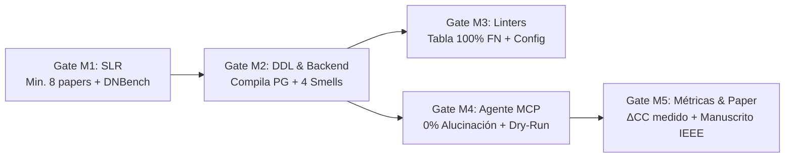

# 🎯 Definición Formal del Problema, Preguntas de Investigación y Objetivos

> **Documento Rector del Proyecto:** Base formal para el Planteamiento del Problema en el Paper Científico (IEEE / ACM).  
> **Integrador / Coordinador General:** Miembro 5  
> **Asignatura:** Calidad de Software — Evaluación $N_2$ (100%)

---

## 1. Planteamiento Formal del Problema

En el desarrollo de software empresarial contemporáneo, el diseño de la base de datos relacional condiciona de forma directa la arquitectura y mantenibilidad del backend. Cuando un esquema en **PostgreSQL** presenta defectos estructurales de normalización (violaciones de 1FN, 2FN o 3FN) o prescinde de restricciones de integridad declarativas (`FOREIGN KEY`), se genera un fenómeno de **traslación de deuda técnica**: la responsabilidad de asegurar la consistencia de los datos se transfiere forzosamente a la capa de aplicación.

El desarrollador se ve obligado a escribir rutinas de **programación defensiva** compuestas por:
1. Bifurcaciones condicionales `if (!exists)` y consultas previas redundantes (`SELECT COUNT(*)`) antes de cada mutación para prevenir registros huérfanos.
2. Deserialización sintáctica manual en memoria (operaciones `split(',')`, expresiones regulares) para atributos multivaluados almacenados en columnas de texto.
3. Transacciones y mecanismos manuales de sincronización para compensar anomalías de actualización generadas por dependencias parciales y transitivas.

### La Brecha de la Industria (La Ceguera de los Linters Tradicionales)
Los pipelines modernos de integración continua (CI/CD) delegan la calidad del código SQL a analizadores estáticos basados en Árboles de Sintaxis Abstracta (AST), tales como **SQLFluff** y **SonarQube**. Sin embargo, estas herramientas sufren de una **ceguera semántica inherente**: validan que la sintaxis gramatical sea correcta y que las palabras clave cumplan con convenciones de estilo, pero son incapaces de comprender la semántica del dominio, las dependencias funcionales entre entidades y la ausencia de restricciones referenciales implícitas. En consecuencia, esquemas relacionales gravemente defectuosos pasan limpios a producción ("*Build Passed*"), forzando al backend a inflar su complejidad ciclomática y acumular deuda técnica.

---

## 2. Preguntas de Investigación (*Research Questions - RQs*)

Para guiar la experimentación cuantitativa y responder a los estándares de publicación IEEE/ACM, la investigación se articula en torno a tres preguntas científicas:

* **$RQ_1$ (Línea Base Tradicional / Ceguera de Herramientas AST):**  
  *¿En qué medida los analizadores estáticos tradicionales basados en Árboles de Sintaxis Abstracta (SQLFluff con dialecto PostgreSQL y SonarQube) omiten defectos semánticos de normalización (1FN, 2FN, 3FN) y omisiones de claves foráneas en esquemas DDL?*
* **$RQ_2$ (Propuesta de Inteligencia Artificial / Agente Autónomo vs Prompts Crudos):**  
  *¿Cómo contrasta la precisión diagnóstica, la tasa de alucinación de restricciones y la tasa de compilación exitosa en PostgreSQL entre un Agente Autónomo asistido por herramientas (LLM + Postgres MCP + Skill procedimental + Dry-Run determinista) frente a modelos de lenguaje evaluados mediante prompts pasivos Zero-Shot y Chain-of-Thought sin herramientas?*
* **$RQ_3$ (Impacto Cuantitativo en Backend / Norma ISO/IEC 25010):**  
  *¿En qué magnitud la refactorización automatizada del esquema relacional en PostgreSQL reduce la Complejidad Ciclomática de McCabe ($CC$), las líneas de código defensivo ($SLOC_{def}$) y la sobrecarga de consultas de verificación previas ($Q_{prev}$) en los servicios de backend, mejorando la mantenibilidad y fiabilidad según ISO/IEC 25010?*

---

## 3. Hipótesis Experimentales

* **$H_1$ (Hipótesis de Línea Base Industrial):**  
  Los linters sintácticos basados en AST (SQLFluff y SonarQube) arrojan un **100% de falsos negativos** ante los 4 defectos relacionales de diseño, aprobando los scripts DDL como válidos.
* **$H_2$ (Hipótesis de Eficacia Agentic AI):**  
  El uso de una arquitectura de Agente Autónomo con introspección activa de catálogo (Postgres MCP) y validación en transacciones Dry-Run (`BEGIN ... ROLLBACK`) alcanza una precisión diagnóstica superior al 90% y reduce al **0% la alucinación de claves foráneas y la emisión de DDL que no compila** en PostgreSQL, superando a los prompts pasivos (que fallan en ~40%).
* **$H_3$ (Hipótesis de Calidad de Software Backend):**  
  La refactorización del esquema hacia 3FN con integridad declarativa completa en PostgreSQL produce una reducción estadísticamente significativa en la Complejidad Ciclomática ($\Delta CC \ge 50\%$) y elimina el 100% de las líneas de código defensivo ($SLOC_{def} \to 0$) y consultas de verificación previas ($Q_{prev} \to 0$).

---

## 4. Objetivos del Proyecto

### 4.1 Objetivo General
Evaluar empíricamente el impacto del uso de modelos de lenguaje mediante una arquitectura de Agente Autónomo asistido por herramientas (MCP) como técnica de aseguramiento de calidad temprano de esquemas PostgreSQL, determinando su capacidad para diagnosticar defectos relacionales y cuantificando la reducción de complejidad ciclomática y deuda técnica en el backend según la norma ISO/IEC 25010.

### 4.2 Objetivos Específicos
1. **OE1 (Estado del Arte - M1):** Sistematizar la literatura internacional mediante una Revisión Sistemática (SLR) sobre *database smells*, normalización con LLMs (benchmark DNBench/MARS 2026) y métricas de complejidad backend.
2. **OE2 (Benchmark Experimental - M2):** Diseñar y construir un benchmark reproducible compuesto por 3 esquemas relacionales en PostgreSQL (Pagila, Northwind-PG y Sintético DNBench) junto a sus correspondientes micro-servicios backend con código defensivo forzado.
3. **OE3 (Evaluación de Línea Base - M3):** Ejecutar una auditoría estática con SQLFluff (`--dialect postgres`) y SonarQube sobre los esquemas defectuosos para documentar empíricamente su tasa de falsos negativos y realizar el análisis de causa raíz.
4. **OE4 (Implementación Agentic AI - M4):** Diseñar, instrumentar y evaluar el Agente Autónomo integrando un modelo LLM de razonamiento con el servidor PostgreSQL MCP, la Skill procedimental `postgres-schema-auditor` y el bucle determinista de validación Dry-Run.
5. **OE5 (Medición Cuantitativa e Integración - M5):** Desarrollar el instrumental de análisis estático automatizado en Python para medir el diferencial $\Delta CC$, $\Delta SLOC_{def}$ y $\Delta Q_{prev}$, validando los resultados y consolidando el artículo científico final para publicación IEEE/ACM.

---

## 5. Criterios de Aceptación del Coordinador (Quality Gates)

1. **Quality Gate M1:** La matriz SLR debe contener al menos 8 artículos científicos Q1/Q2/conferencias core, incluyendo obligatoriamente a *Codd (1970)*, *McCabe (1976)*, *Sharma et al. (2018)* y el benchmark *DNBench / MARS (2026)*.
2. **Quality Gate M2:** Los scripts `schema_defective.sql` y `schema_ground_truth.sql` deben ser sintaxis nativa ejecutable en PostgreSQL 16/17 sin errores. El backend defensivo debe aislar claramente el código defensivo del código de negocio.
3. **Quality Gate M3:** La configuración `.sqlfluff` debe usar `--dialect postgres`. La tabla experimental debe contrastar sintaxis vs semántica.
4. **Quality Gate M4:** El DDL generado por el agente debe aprobar el 100% de transacciones Dry-Run en PostgreSQL y no inventar restricciones no justificadas en las dependencias funcionales.
5. **Quality Gate M5:** El script de medición (`measure_quality.py`) debe procesar los endpoints de M2, computar deterministamente los deltas porcentuales y verificar el control de amenazas a la validez antes de volcar las tablas al borrador final del paper.

