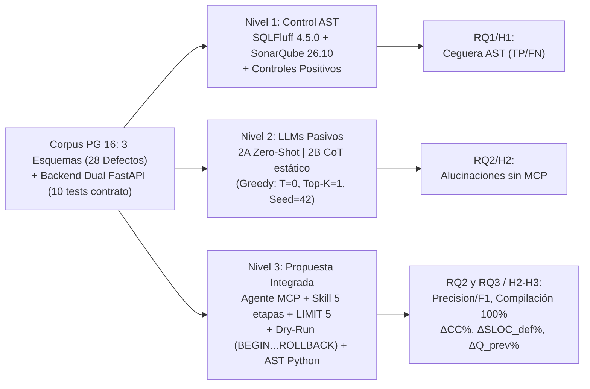

# Auditoría y Optimización de Esquemas PostgreSQL mediante LLMs para el Aseguramiento de la Calidad del Backend

> **Entregable Temporal Consolidado — Avance hasta Metodología (Secciones I–III)**  
> **Formato:** Estructura IMRyD Parcial (IEEE / ACM) | **Asignatura:** Calidad de Software (Ciclo 6) — Evaluación $N_2$  
> **Docente Asesor:** Mg. Gustavo Arredondo Castillo | **Alcance:** Solo Planteamiento, SLR y Metodología (excluye Resultados y Discusión).

---

## Resumen

Los defectos estructurales en esquemas relacionales —violaciones de normalización (1FN–3FN) y omisión de claves foráneas (*keyless entry*)— trasladan deuda técnica hacia el código *backend*, forzando rutinas defensivas (`split()`, `SELECT COUNT(*)`) que elevan la Complejidad Ciclomática de McCabe ($CC$) y exponen al sistema a condiciones de carrera (TOCTOU). Paralelamente, los linters AST empleados en CI/CD (**SQLFluff** y **SonarQube**) permanecen ciegos ante la semántica relacional, mientras los LLMs pasivos alucinan restricciones cuando operan sin contexto vivo. Este entregable sintetiza la fundamentación bibliográfica y la metodología experimental tripartita estandarizada al 100% en **PostgreSQL 16**: un corpus de tres esquemas (**Pagila**, **Northwind-PG** y un caso sintético estilo **DNBench**, totalizando 28 defectos) acoplado a un *backend* dual equivalente en Python 3.12 / FastAPI, contrastando herramientas AST, *prompts* pasivos y un **Agente Autónomo vía MCP con validación *Dry-Run*** (`BEGIN...ROLLBACK`), evaluado mediante métricas AST ($CC$, $SLOC_{def}$, $Q_{prev}$, $\Delta\%$) alineadas con **ISO/IEC 25010**.

**Palabras Clave:** *Database Schema Smells*, LLMs, *Model Context Protocol* (MCP), *Dry-Run*, Complejidad Ciclomática, ISO/IEC 25010, PostgreSQL.

---

## I. Introducción y Planteamiento del Problema

### A. Acoplamiento Esquema–Backend y Ceguera del Análisis Estático
De acuerdo con la teoría relacional de Codd [1], la normalización y la integridad referencial declarativa erradican anomalías de modificación dentro del motor gestor. Sin embargo, en la práctica industrial persisten antipatrones catalogados por Karwin [5] y formalizados por Sharma et al. [7], quienes tras auditar 2,925 repositorios demostraron que los ORMs no previenen 13 tipos de *database schema smells* y que su densidad crece con el tamaño del esquema. Cuando se omiten claves foráneas (*keyless entry* [5]), se guardan listas CSV en texto (*jaywalking* / 1FN) o subsisten dependencias parciales (2FN) y transitivas (3FN), la lógica de consistencia migra al *backend* como **programación defensiva**. Siguiendo a McCabe [2] y el NIST [3], cada bifurcación y verificación existencial añadida infla el Grafo de Flujo de Control ($CC$), degrada la mantenibilidad y fiabilidad definidas en ISO/IEC 25010 [6] y expone las mutaciones concurrentes a ventanas TOCTOU, agravadas por datos ruidosos (*data smells* [9]).

Para mitigar fallos tempranos, los flujos CI/CD emplean analizadores AST como SQLFluff [19] y SonarQube; no obstante, estudios recientes como *SQLMentor* [13] y *SQLFlex* [15] confirman que los enfoques basados en gramáticas verifican conformidad léxica o dialectal sin diagnosticar dependencias funcionales ni diseño DDL. Por otra parte, aunque la investigación LLM privilegió el *Text-to-SQL* (*Spider* [8], *BIRD* [11]), marcos recientes orientados a esquemas y remediación **DDL-to-DDL** (*Miffie* [12], *DNBench/MARS* [14], *NormaScore* [16], de Medeiros et al. [17]) advierten que los LLMs sin herramientas alucinan restricciones, y detienen su evaluación en la base de datos sin cuantificar el beneficio en el *backend*.

### B. Preguntas de Investigación, Hipótesis y Objetivos

* **$RQ_1$ (Línea Base AST):** *¿En qué medida SQLFluff (`postgres`) y SonarQube omiten violaciones 1FN–3FN y ausencias de claves foráneas en scripts DDL?*
  * **$H_1$:** Arrojan un **100% de falsos negativos** frente a los cuatro defectos semánticos evaluados, aprobando el DDL sintácticamente válido.
* **$RQ_2$ (Agente MCP vs. Prompts Pasivos):** *¿Cómo difieren la precisión diagnóstica, la alucinación de FKs y la compilación en PostgreSQL entre un Agente MCP + Skill + Dry-Run y prompts Zero-Shot/CoT sin herramientas?*
  * **$H_2$:** El Agente Autónomo supera el **90% de precisión diagnóstica** y reduce al **0% la alucinación de FKs y el DDL inejecutable**, superando a los *prompts* crudos (para los cuales se hipotetiza $\ge 40\%$ de fallos globales entre alucinaciones y errores estructurales reportados en [14]).
* **$RQ_3$ (Impacto Backend e ISO/IEC 25010):** *¿Cuánto reduce la normalización declarativa en PostgreSQL las métricas $CC$, $SLOC_{def}$ y $Q_{prev}$ en el backend?*
  * **$H_3$:** Logra $\Delta CC \ge 50\%$ y elimina el **100% del código defensivo ($SLOC_{def} \to 0$) y consultas previas ($Q_{prev} \to 0$)**.

**Objetivo General:** Diseñar y evaluar empíricamente un marco basado en Agente Autónomo (LLM + MCP + *Dry-Run*) para el aseguramiento temprano de calidad de esquemas PostgreSQL, cuantificando su eficacia diagnóstica frente a linters AST y *prompts* pasivos, así como la reducción de deuda técnica en el *backend* bajo ISO/IEC 25010 [6].  
**Objetivos Específicos:** **$OE_1$** Sistematizar el estado del arte (SLR); **$OE_2$** Construir el corpus PostgreSQL 16 (3 esquemas) y un *backend* dual equivalente en FastAPI; **$OE_3$** Auditar la línea base AST con controles positivos; **$OE_4$** Instrumentar la *Skill* en 5 etapas, MCP y validación `BEGIN...ROLLBACK`; **$OE_5$** Medir deterministamente $CC$, $SLOC_{def}$ y $Q_{prev}$ vía AST en Python.

---

## II. Estado del Arte y Marco Teórico (SLR)

### A. Protocolo de Búsqueda y Síntesis de Ejes
Se ejecutó una Revisión Sistemática en IEEE Xplore, ACM Digital Library, Scopus, MDPI, NeurIPS/EMNLP/ICSE/SIGMOD y arXiv hasta octubre de 2026 mediante la ecuación: `("LLM" OR "Autonomous Agent" OR "MCP") AND ("database schema" OR "schema normalization" OR "database smells") AND ("static analysis" OR "backend maintainability" OR "cyclomatic complexity")`, consolidando **17 referencias primarias verificadas** (más especificaciones técnicas [18]–[20]) agrupadas en tres ejes:
1. **Fundamentos Relacionales y Límites AST:** Codd [1] y Ambler y Sadalage [4] fijan las bases de normalización y refactorización segura; Karwin [5] y Sharma et al. [7] vinculan los *smells* con código cliente defensivo, mientras *SQLMentor* [13] y *SQLFlex* [15] evidencian que los analizadores basados en AST (`sqlglot`, ANTLR, SQLFluff) no auditan el modelado relacional DDL.
2. **De *Text-to-SQL* a *DDL-to-DDL* con LLMs:** *Spider* [8] y *BIRD* [11] mostraron que datos sucios [9] degradan modelos sin inspección viva; aunque *Chain-of-Thought* [10] mejora inferencia textual, trabajos específicos de normalización y reparación DDL —*Miffie* [12], *DNBench/MARS* [14], *NormaScore* [16] y de Medeiros et al. [17]— confirman que sin verificación determinista persisten fallos de inferencia de dependencias y sobrenormalización, sin conectar dichas mejoras con la aplicación *backend*.
3. **Métricas de Software e ISO/IEC 25010:** McCabe [2] y Watson & McCabe [3] fundamentan $v(G)$ como predictor cuantitativo de complejidad lógica y esfuerzo de pruebas ($v(G) \le 10$), operacionalizado sobre atributos de *Mantenibilidad* y *Fiabilidad* de ISO/IEC 25010 [6].

### B. Matriz Comparativa Esencial y Brechas Identificadas

**Tabla I.** Síntesis de estudios clave del Estado del Arte y vacíos cubiertos por la presente investigación.

| Referencia | Foro / Año | Enfoque Técnico | Alcance DDL / BD | Limitación / Brecha frente a este Estudio |
| :--- | :---: | :--- | :--- | :--- |
| **Codd [1]** | *ACM CACM* (1970) | Álgebra relacional (1FN–3FN) | Teórico formal | Sin automatización ni métricas de software. |
| **McCabe [2] / NIST [3]** | *IEEE* (1976) / 1996 | Grafo $CFG$ y complejidad $v(G)$ | N/A (Software) | Cuantifica complejidad lógica sin vincularla al DDL. |
| **Ambler [4] / Karwin [5]** | Libros (2006/2010) | Refactoring evolutivo y antipatrones | *Jaywalking*, *Keyless Entry* | Explica acoplamiento manual sin medición $\Delta CC$ ni IA. |
| **Sharma et al. [7]** | *ICSE-SEIP* (2018) | Herramienta *DbDeo* (2,925 repos) | 13 *Schema Smells* | Prueba prevalencia con ORMs; no normaliza ni mide *backend*. |
| **Li et al. (*BIRD*) [11]** | *NeurIPS* (2023) | Benchmark SQL con datos ruidosos | Solo `SELECT` (*Text-to-SQL*) | Demuestra colapso sin inspección de datos; no audita DDL. |
| **Jo et al. (*Miffie*) [12]** | *arXiv* (2025) | Auto-refinamiento dual-LLM | 1FN–BCNF | Sin *Dry-Run* en motor vivo ni impacto *backend*. |
| **Miggiano (*SQLMentor*) [13]** | Tesis MSc (2025) | Reglas AST (`sqlglot`) vs. LLMs | Errores en consultas SQL | Enfoque en consultas; no audita diseño DDL productivo. |
| **An et al. (*SQLFlex*) [15]** | *ACM PACMMOD* (2026) | ANTLR + `GPT-4.1` multidialecto | Parsing de consultas | Resuelve fragilidad de SQLFluff; omite normalización y *backend*. |
| **Koh et al. (*DNBench/MARS*) [14]** | *arXiv* (2026) | 3,275 casos + Multi-Agente | 1FN–BCNF | Referente directo en DDL; se detiene dentro de la BD. |
| **Ramachandran (*NormaScore*) [16]** | *MDPI BDCC* (2026) | `Qwen2.5-7B` RL + cierre exacto | 1FN–3FN (*NormaBench*) | Calificación académica; sin ejecución viva ni métricas $\Delta CC$. |
| **de Medeiros et al. [17]** | *LLM4Code* (2026) | Remediación LLM **DDL-to-DDL** | PK/FK y normalización | Repara DDL de forma explicable, pero no mide $\Delta$ en *backend*. |

**Brechas Críticas Resultantes:** (1) Escasa validación empírica end-to-end en **DDL-to-DDL** [17] frente al sesgo hacia *Text-to-SQL* [8], [11]; (2) ceguera semántica AST [13], [15] frente a alucinación de LLMs sin *grounding* ni transacciones reales [10], [14]; y (3) **desconexión total** en la literatura previa entre normalización automatizada y reducción medible de deuda técnica en *backend* [6].

---

## III. Metodología Experimental y Diseño Instrumental

### A. Diseño Tripartito y Estandarización en PostgreSQL 16
Se adopta un estudio **cuantitativo comparativo controlado** en tres niveles sobre **PostgreSQL 16** en contenedores aislados (Figura 1), evaluando como variable independiente el método de auditoría/estado del esquema, bajo invariantes estrictas (mismo motor, semillas con huella SHA-256, inferencia determinista y equivalencia funcional por pruebas de contrato), y midiendo $TP, FP, FN, Precision, Recall, F_1$, Compilación (%), Alucinación (%) y $\Delta CC, \Delta SLOC_{def}, \Delta Q_{prev}$.

*Figura 1. Arquitectura metodológica tripartita e instrumentación sobre PostgreSQL 16.*

**Justificación del Motor Único (PostgreSQL 16):** (1) *Aislamiento de la variable independiente*, evitando ruido sintáctico o disparidad de motores (p. ej., MySQL MyISAM vs. InnoDB); (2) *adherencia estricta ANSI SQL y ACID* (`GENERATED ALWAYS AS IDENTITY`, `FOREIGN KEY`, transacciones DDL atómicas `BEGIN...ROLLBACK` [18]); (3) *liderazgo industrial*, motor `#1` tres años seguidos en *Stack Overflow Developer Survey* (`45.55%` en 2023 $\to$ `55.6%` global y `58.2%` profesional en 2025 [20]); y (4) *puertos canónicos y soporte AST nativo* en SQLFluff (`postgres` [19]) y SonarQube (`pssqlv2`).

### B. Corpus Experimental (3 Esquemas, 28 Defectos) y Backend Dual

Siguiendo a Sharma et al. [7] y el paradigma sintético de *DNBench* [14], el corpus combina dos puertos industriales y un control sintético (**Tabla II**). Cada caso incluye `schema_defective.sql`, `schema_ground_truth.sql`, `seed_defective.sql` (datos con huérfanos y delimitadores mixtos para forzar *grounding* [9], [11]) y `defects_manifest.json` (incluyendo `known_native_smells` heredados para no sesgar falsos positivos).

**Tabla II.** Corpus experimental en PostgreSQL 16 (28 defectos en 4 categorías: **D1** 1FN, **D2** 2FN, **D3** 3FN, **D4** Falta de FK).

| Caso de Estudio | Tablas (Def $\to$ GT) | Defectos (D1/D2/D3/D4) | Alcance y Anomalías Inyectadas Principales |
| :--- | :---: | :---: | :--- |
| **1. Pagila** (`case1_pagila`) | $15 \to 16$ | **10** (`1`/`2`/`2`/`5`) | Puerto Sakila PG [18] (núcleo sin extensiones): CSV en `film.special_features`, 2FN en `film_actor`/`film_category`, 3FN en `inventory`/`address`, 5 FKs omitidas; huérfanos (`film_id=999`). |
| **2. Northwind-PG** (`case2_northwind`) | $14 \to 15$ | **10** (`1`/`2`/`1`/`6`) | Puerto `northwind_psql` (14 tablas, `order_id IDENTITY`): `customers.phones` CSV mixto, 2FN en `order_details`, 3FN `orders.shipper_name`, 6 FKs omitidas; huérfanos (`'ZZZZZ'`, `product_id=999`). |
| **3. Sintético Control** (`case3_synthetic`) | $5 \to 7$ | **8** (`1`/`2`/`1`/`4`) | Micro-benchmark estilo **DNBench** [14] libre de ruido heredado (`clientes`, `productos`, `pedidos`, `detalle_pedido`, `envios`): delimitadores `[,;]`, `codigo_postal -> ciudad`, 4 FKs omitidas. |

**Taxonomía Auditada y Traslación al Backend:** **D1 (1FN / *Jaywalking* [1], [5])** exige `split()`/`re.split` en aplicación; **D2 (2FN [1], [7])** obliga a sincronizar atributos redundantes en tablas puente N:M; **D3 (3FN [1], [14])** fuerza consultas maestras duplicadas ante dependencias transitivas; **D4 (*Keyless Entry* [5])** obliga a ejecutar `SELECT COUNT(*)` e `if not exists` previos, generando sobrecarga $Q_{prev}$ y condiciones TOCTOU.  
Para medir $RQ_3$, se implementaron dos servicios equivalentes en **Python 3.12 + FastAPI + `asyncpg`** sobre Pagila y Northwind-PG (**7 endpoints**, ejercitando **12 de los 20 defectos**): `backend_defensive/` aísla las compensaciones entre marcadores `# >>> DEFENSIVE-BEGIN/END` (separadas de DTOs Pydantic), mientras `backend_normalized/` usa `JOIN`, `array_agg` y excepciones nativas (`ForeignKeyViolationError`). Ambos deben aprobar idénticamente **10 pruebas de contrato en `pytest`** (`tests/test_contract.py`) como control estricto de validez interna.

### C. Protocolo por Niveles Experimentales (Linters AST vs. LLMs)

**Tabla III.** Configuración comparativa de los tres niveles experimentales.

| Nivel / Condición | Herramientas y Configuración Verificada | Propósito Experimental |
| :--- | :--- | :--- |
| **Nivel 1: Control AST** | **SQLFluff 4.5.0** (`dialect=postgres`, `templater=raw`, 79 reglas sin exclusión [19]) y **SonarQube 26.10 + `sonar-sql-plugin` 1.4.0** (`pssqlv2`, 20 reglas). Entradas selladas con SHA-256 y **2 controles positivos** (`control_style.sql` $\to$ `LT01`, `header_control.sql` $\to$ `SQLCC:C030`). | Verificar $H_1$: descartar fallos de configuración y puntuar $TP$ únicamente ante diagnóstico semántico real en `matriz_deteccion.csv`. |
| **Nivel 2: LLM Pasivo** (`EXP-01,02,04,05,07,08`) | **2A Zero-Shot** (solo `schema_defective.sql`) y **2B CoT Estático** (pasos de `SKILL.md` [10] sin MCP), bajo *Greedy Decoding* en `config/inference_config.json` ($T=0.0$, $Top\text{-}K=1$, $\text{seed}=42$, `gemini-3.8-flash`, presupuesto `high`). | Medir el techo y las tasas de alucinación al razonar en texto plano sin acceso al catálogo ni tuplas vivas. |
| **Nivel 3: Agente MCP** (`EXP-03,06,09`) | LLM (mismo perfil determinista) + `@modelcontextprotocol/server-postgres` (`mcp_postgres.json`) + `introspect_db.py` + `postgres-schema-auditor/SKILL.md` (5 etapas: catálogo `information_schema`, muestreo empírico `LIMIT 5` [11], inferencia de dependencias, clasificación y DDL PG 16) + arnés **`dry_run_validator.py`** (`BEGIN...ROLLBACK` vía `psycopg` con bucle correctivo por `SQLSTATE`). | Evaluar $H_2$: alcanzar precisión $>90\%$, `0%` alucinaciones FK y `100%` compilación determinista sin alterar el servidor. |

Para Niveles 2–3 se calculan $\text{Precision} = \frac{TP}{TP+FP}$, $\text{Recall} = \frac{TP}{TP+FN}$, $F_1 = \frac{2PR}{P+R}$, **Tasa de Compilación DDL (%)** y **Tasa de Alucinación de FKs (%)** frente a `defects_manifest.json` y `schema_ground_truth.sql`.

### D. Marco Métrico Backend, Instrumentación AST e ISO/IEC 25010

Se eligió **Python 3.12 + AST nativo + `radon` v6.0+** por tres razones metodológicas: (1) determinismo sintáctico del módulo estándar `ast` previo formateo con `black --line-length 88`, evitando divergencias entre *parsers* JS; (2) separación declarativa de validaciones HTTP en Pydantic frente al cuerpo de los controladores; y (3) alineación con el ecosistema científico de benchmarks SQL-LLM [8], [11], [14]. El script determinista `measure_quality.py` (calibrado con `test_sample_backend.py`) inspecciona el rango AST `[start_line, end_line]` de cada endpoint (`FunctionDef`/`AsyncFunctionDef`):

1. **Complejidad Ciclomática ($CC$ [2], [3]):** $CC = E - N + 2P = 1 + \sum_{i=1}^{k}\pi_i$, contabilizando nodos `If`, `IfExp`, `For`, `AsyncFor`, `While`, `ExceptHandler`, `Assert`, `comprehension`, `BoolOp` y `Match`, clasificados en escala Radon (Rango **A**: $1$–$5$, **B**: $6$–$10$, **C–F**: $>10$).
2. **Líneas Defensivas ($SLOC_{def}$) y Consultas Previas ($Q_{prev}$):** Sentencias ejecutables delimitadas en `DEFENSIVE-BEGIN/END` (excluyendo DTOs, comentarios e infraestructura) y llamadas previas `SELECT COUNT(*)/EXISTS/1` antes de mutar.
3. **Diferenciales Relativos ($\Delta\%$):** Para $M \in \{CC, SLOC_{def}, Q_{prev}\}$, $\Delta M(\%) = \frac{M_{\text{def}} - M_{\text{norm}}}{M_{\text{def}}} \times 100\%$.
4. **Mapeo ISO/IEC 25010 [6]:** Menor $CC$ (hacia Rango A) y $SLOC_{def} \to 0$ elevan **Mantenibilidad** (*Analizabilidad* y *Modificabilidad*); eliminar $Q_{prev}$ mediante `FOREIGN KEY` y 3FN eleva **Fiabilidad** (*Integridad* y *Tolerancia a fallos*) cerrando ventanas TOCTOU vía atomicidad ACID.

### E. *Quality Gates* Cruzados y Control de Amenazas a la Validez

El coordinador exige cinco *Quality Gates* secuenciales previos al análisis de resultados: **(M1)** $\ge 8$ fuentes SLR con [1], [2], [5], [7], [14]–[17]; **(M2)** compilación limpia en PG 16 + `10/10` tests `pytest`; **(M3)** SHA-256 + `--dialect postgres` + controles positivos; **(M4)** *Greedy Decoding* + `100%` *Dry-Run* sin FKs inventadas; y **(M5)** calibración AST tras `black`. Asimismo, se controlan las amenazas a la validez de **Constructo** (conteo estricto sobre rangos AST tras `black`), **Interna** (compilación previa, `seed=42`, suite `pytest` compartida), **Externa** (3 escalas/dominios, reportando cobertura real $12/20$ en rutas REST) y **Operacional** (saneamiento de huérfanos acotado al *sandbox* experimental).

---

## Referencias Bibliográficas Verificadas

1. E. F. Codd, "A Relational Model of Data for Large Shared Data Banks," *Commun. ACM*, vol. 13, no. 6, pp. 377–387, 1970, doi: `10.1145/362384.362685`.
2. T. J. McCabe, "A Complexity Measure," *IEEE Trans. Softw. Eng.*, vol. SE-2, no. 4, pp. 308–320, 1976, doi: `10.1109/TSE.1976.233837`.
3. A. H. Watson and T. J. McCabe, *Structured Testing: A Testing Methodology Using the Cyclomatic Complexity Metric*, NIST SP 500-235, 1996.
4. S. W. Ambler and P. J. Sadalage, *Refactoring Databases: Evolutionary Database Design*, Addison-Wesley, 2006.
5. B. Karwin, *SQL Antipatterns: Avoiding the Pitfalls of Database Programming*, Pragmatic Bookshelf, 2010.
6. ISO/IEC, *Systems and software Quality Requirements and Evaluation (SQuaRE) — Product quality model*, ISO/IEC 25010:2011, 2011.
7. T. Sharma et al., "Smelly Relations: Measuring and Understanding Database Schema Quality," in *Proc. ICSE-SEIP '18*, ACM, pp. 14–23, 2018, doi: `10.1145/3183519.3183529`.
8. T. Yu et al., "Spider: A Large-Scale Human-Labeled Dataset for Complex and Cross-Domain Semantic Parsing and Text-to-SQL Task," in *Proc. EMNLP*, ACL, pp. 3911–3921, 2018.
9. H. Foidl, M. Felderer, and R. Ramler, "Data Smells: Categories, Causes and Consequences, and Detection of Suspicious Data in AI-based Systems," in *Proc. IEEE/ACM CAIN '22*, pp. 229–239, 2022, doi: `10.1145/3522664.3528590`.
10. J. Wei et al., "Chain-of-Thought Prompting Elicits Reasoning in Large Language Models," in *NeurIPS*, vol. 35, pp. 24824–24837, 2022.
11. J. Li et al., "Can LLM Already Serve as A Database Interface? A Big Bench for Large-Scale Database Grounded Text-to-SQLs," in *NeurIPS*, vol. 36, 2023.
12. E. Jo, N. Lee, and G. Kim, "Database Normalization via Dual-LLM Self-Refinement," *arXiv preprint arXiv:2508.17693*, 2025.
13. D. Miggiano, "Automatic Categorisation of SQL Errors," M.S. thesis, DIBRIS, Università di Genova, Oct. 2025.
14. D.-J. Koh et al., "Can LLMs Normalize Databases? A Benchmark and Multi-Agent Framework for Schema Normalization," *arXiv preprint arXiv:2609.11141*, 2026.
15. J. An, K. Mahathevan, and M. Rigger, "Dialect-Agnostic SQL Parsing via LLM-Based Segmentation," *Proc. ACM Manag. Data (PACMMOD)*, vol. 4, no. 3, art. 161, 2026, doi: `10.1145/3802038`.
16. R. Ramachandran et al., "NormaScore: Intelligent Database Normalization Assessment Framework for DBMS Education," *Big Data Cogn. Comput.*, MDPI, vol. 10, no. 10, art. 343, Oct. 2026, doi: `10.3390/bdcc10100343`.
17. A. S. de Medeiros et al., "LLM-Driven SQL Remediation: Towards Safe and Explainable Code for Automated Schema Refactoring," in *Proc. LLM4Code '26 (ICSE)*, pp. 143–150, 2026.
18. PostgreSQL Global Development Group, *PostgreSQL 16 Documentation*, 2024. Disponible en: `https://www.postgresql.org/docs/16/`
19. SQLFluff Maintainers, *SQLFluff Documentation (PostgreSQL Dialect)*, 2026. Disponible en: `https://docs.sqlfluff.com/`
20. Stack Overflow, *Developer Survey — Most Popular Technologies (Databases, 2023–2025)*, 2025. Disponible en: `https://survey.stackoverflow.co/2025/`
